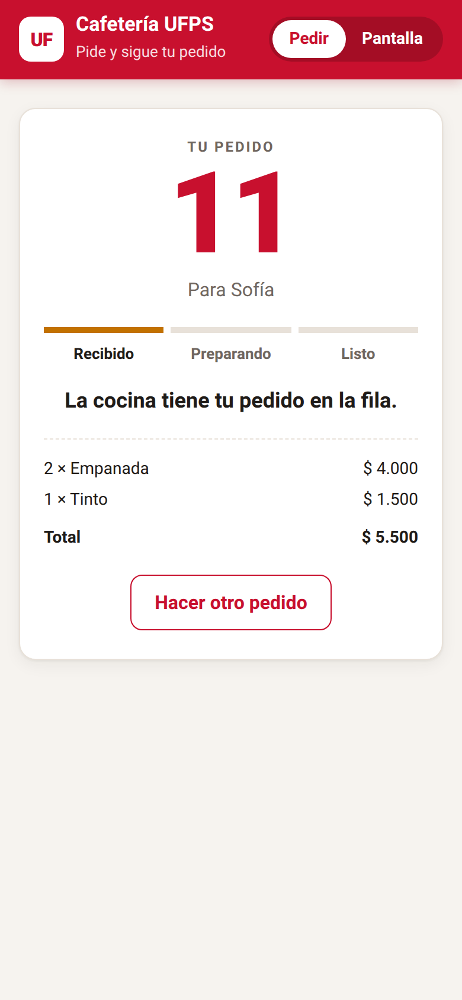
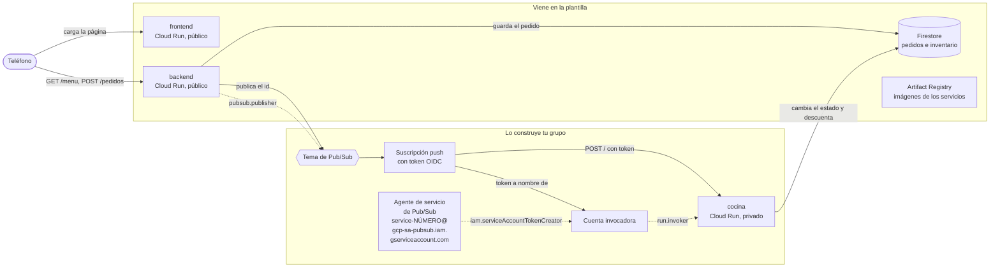

# Cafetería asíncrona

Una cafetería universitaria donde pides desde el teléfono y la respuesta llega de inmediato: "pedido recibido, número 11". Desde ahí la cocina trabaja por su cuenta y el pedido avanza solo por `recibido`, `preparando` y `listo`. Nadie se queda mirando la pantalla mientras le preparan el café; la página consulta el estado cada pocos segundos y te avisa cuando puedes ir a recogerlo.

Para lograrlo, el backend no le pide nada a la cocina directamente. Guarda el pedido en Firestore, deja un mensaje en un tema de Pub/Sub y responde. Pub/Sub le entrega ese mensaje a la cocina, un servicio privado en Cloud Run que nadie más puede llamar. La plantilla trae las tres aplicaciones completas y la infraestructura del frontend y el backend; tu grupo construye en Terraform todo lo que conecta al backend con la cocina.

| Pedir | Seguir el pedido | Pantalla de la cafetería |
|---|---|---|
|  |  |  |

Si el frontend no logra hablar con el backend, lo dice en vez de quedarse en blanco:


## Arquitectura al terminar la práctica



Las flechas punteadas son los permisos de IAM que da tu grupo. La etiqueta es el rol sin el prefijo `roles/` y la flecha llega al recurso sobre el que se da: el backend puede publicar solo en ese tema, el agente de Pub/Sub puede firmar tokens como la cuenta invocadora y esa cuenta puede invocar solo a la cocina.

En la plantilla, el backend ya sabe publicar, pero la variable `TEMA` está vacía: guarda el pedido, registra una advertencia y no avisa a nadie. Por eso, recién desplegada, la cafetería recibe pedidos que se quedan en `recibido` para siempre.

## Estructura del repositorio

```
backend/main.py            API en Flask: menú, pedidos, inventario y publicación en Pub/Sub
backend/requirements.txt   Dependencias del backend con versión fija
backend/Dockerfile         Imagen del backend con gunicorn
cocina/main.py             Worker que recibe las entregas push y prepara los pedidos
cocina/requirements.txt    Dependencias de la cocina con versión fija
cocina/Dockerfile          Imagen de la cocina con gunicorn
frontend/index.html        La página: vista para pedir y pantalla de la cafetería
frontend/server.py         Servidor sin dependencias que inyecta BACKEND_URL en la página
frontend/Dockerfile        Imagen del frontend
infra/providers.tf         Versión de Terraform y del proveedor de Google
infra/variables.tf         Proyecto, prefijo, región e imágenes
infra/main.tf              APIs, registro, Firestore, backend y frontend con sus cuentas
infra/outputs.tf           Ruta del registro y URL de los servicios
infra/terraform.tfvars.example   Ejemplo de valores; cópialo como terraform.tfvars
docs/api.md                Endpoints del backend y formato del mensaje de Pub/Sub
docs/estados.md            Ciclo de vida de un pedido y quién hace cada cambio
docs/capturas/             Capturas de la aplicación usadas en este README
.gitignore                 Deja por fuera el estado de Terraform, tus tfvars y __pycache__
```

## Cómo empezar

### Flujo de trabajo

1. Crea el repositorio de tu grupo con **Use this template** en GitHub.
2. Edita en VS Code o en github.dev (tecla `.` en la página del repositorio).
3. Haz commit y push desde el editor.
4. En Cloud Shell clonas la primera vez y traes los cambios con `git pull` después. Desde Cloud Shell nunca haces push.
5. Docker y Terraform se ejecutan siempre en Cloud Shell. La consola de Google Cloud es para mirar y diagnosticar, no para crear recursos.

### Primer despliegue

En Cloud Shell:

```bash
git clone https://github.com/<tu-usuario>/<tu-repositorio>.git
cd <tu-repositorio>/infra
cp terraform.tfvars.example terraform.tfvars
cloudshell edit terraform.tfvars
```

En `terraform.tfvars` pon el ID de tu proyecto y el prefijo del grupo, y ajusta las rutas de las imágenes a esos mismos valores. Este archivo vive solo en Cloud Shell: el `.gitignore` evita que llegue a GitHub.

El orden importa, porque las imágenes necesitan el registro y los servicios necesitan las imágenes:

```bash
# 1. Solo el registro (y las APIs de las que depende)
terraform init
terraform apply -target=google_artifact_registry_repository.registro

# 2. Las imágenes
REGISTRO=$(terraform output -raw registro)
gcloud auth configure-docker us-central1-docker.pkg.dev --quiet
cd ..
docker build -t $REGISTRO/backend:v1 backend
docker push $REGISTRO/backend:v1
docker build -t $REGISTRO/frontend:v1 frontend
docker push $REGISTRO/frontend:v1

# 3. Todo lo demás
cd infra
terraform apply
terraform output
```

Abre `url_frontend` en el teléfono. Si usas otra región, cambia `us-central1` en el comando de `gcloud auth configure-docker`.

Cuando cambies el código de un servicio, construye y sube la imagen con una etiqueta nueva (`v2`, `v3`...), actualízala en `terraform.tfvars` y vuelve a aplicar. Si subes otra vez la misma etiqueta, Terraform no ve ningún cambio y Cloud Run sigue con la versión anterior.

## Probar cada servicio con `docker run`

Antes de subir una imagen, pruébala en Cloud Shell. Para ver una página servida en Cloud Shell usa **Vista previa en la Web** y elige el puerto.

**Frontend.** No necesita credenciales:

```bash
docker run --rm -p 8080:8080 -e BACKEND_URL=https://<url-del-backend> $REGISTRO/frontend:v1
```

Abre la vista previa en el puerto 8080. Si no pasas `BACKEND_URL`, verás el mensaje de error de la captura de arriba.

**Backend sin Firestore.** El contenedor arranca aunque no tenga credenciales; la validación de pedidos no toca la base, así que puedes comprobarla:

```bash
docker run --rm -d --name backend -p 8081:8080 $REGISTRO/backend:v1
curl -i -X POST localhost:8081/pedidos -H 'Content-Type: application/json' -d '{"cliente": "Ana", "items": []}'
docker logs backend
docker rm -f backend
```

Debe responder `400` con el error en JSON.

**Backend con Firestore.** Cuando la base ya existe (después del primer `terraform apply` completo), puedes darle al contenedor tus propias credenciales:

```bash
gcloud auth application-default login
docker run --rm -d --name backend -p 8081:8080 \
  -e GOOGLE_CLOUD_PROJECT=<tu-proyecto> \
  -e BASE_DATOS=<prefijo>-cafeteria \
  -e GOOGLE_APPLICATION_CREDENTIALS=/adc.json \
  -v $HOME/.config/gcloud/application_default_credentials.json:/adc.json:ro \
  $REGISTRO/backend:v1
curl localhost:8081/menu
curl -X POST localhost:8081/pedidos -H 'Content-Type: application/json' \
  -d '{"cliente": "Ana", "items": [{"producto": "tinto", "cantidad": 1}]}'
```

**Cocina.** Escucha en `/` el mismo sobre que le entregaría Pub/Sub. Con las mismas credenciales, puedes hacerte pasar por Pub/Sub y entregarle a mano un pedido que esté en `recibido`:

```bash
docker build -t cocina cocina
docker run --rm -d --name cocina -p 8082:8080 \
  -e GOOGLE_CLOUD_PROJECT=<tu-proyecto> \
  -e BASE_DATOS=<prefijo>-cafeteria \
  -e GOOGLE_APPLICATION_CREDENTIALS=/adc.json \
  -v $HOME/.config/gcloud/application_default_credentials.json:/adc.json:ro \
  cocina
ID=<id de un pedido en recibido>
curl -i -X POST localhost:8082/ -H 'Content-Type: application/json' \
  -d "{\"message\": {\"data\": \"$(printf %s "$ID" | base64)\"}, \"deliveryAttempt\": 1}"
docker logs cocina
```

Responde `204` cuando termina, unos segundos después. Mira el pedido en la pantalla de la cafetería: acabas de hacer a mano lo que Pub/Sub va a hacer solo.

La cocina tiene dos variables para provocar fallas: `TIEMPO_PREPARACION` (segundos que tarda, 6 por defecto) y `PROBABILIDAD_FALLO` (entre 0 y 1; con esa probabilidad responde `500` después de haber terminado el trabajo). Los detalles están en [docs/api.md](docs/api.md) y el recorrido de un pedido en [docs/estados.md](docs/estados.md).

El plato misterioso falla siempre, y sin un tema de mensajes muertos Pub/Sub lo sigue reintentando mientras retenga el mensaje, que por defecto son 7 días. Cada intento deja un error en los logs de la cocina, así que se van a llenar hasta que tu grupo resuelva esa parte del reto.

---

# Informe del grupo

## Integrantes

| Nombre | Código | Usuario de GitHub |
|---|---|---|
|Juan Camilo Uribe | 1152326 | camilo2212 |

## URL de la cafetería

Frontend:

## Diagrama propio

<!-- Tu diagrama en Mermaid de lo que desplegaste, con los nombres reales de tus recursos. -->

## Evidencias por fase

<!-- Una subsección por cada fase de la guía, con capturas o salidas de comandos y unas líneas de lo que observaste. -->

## Decisiones del reto

El reto tenía dos problemas que Pub/Sub provoca por su forma de entregar mensajes: un mismo pedido puede llegar más de una vez (y descontar el inventario de más), y el plato misterioso se reintenta sin parar. Cada decisión de abajo responde una de las cuatro que pide la guía.

### 1. Cómo sabe la cocina que un pedido ya se preparó

**Qué cambiamos** (`cocina/main.py`):

- Al llegar un mensaje, la cocina lee el campo `estado` del pedido. Si ya es `listo` o `rechazado`, responde `204` sin preparar nada.
- Revisar el inventario, descontarlo y pasar el pedido a `listo` (o `rechazado`) ocurre ahora en **una sola transacción de Firestore**, y dentro de ella se vuelve a leer `estado`.

**Por qué:**

- *El dato que consulta es el estado del pedido.* El pedido ya dice si terminó, así que no hace falta una segunda fuente de verdad. La alternativa era guardar los `messageId` vistos en una colección nueva; la descartamos porque habría que mantenerla y limpiarla, y porque el estado hace el mismo trabajo. Tampoco podíamos pedirle a Pub/Sub entrega exactamente una vez: esa opción existe solo para suscripciones pull, y la nuestra es push.
- *La revisión de antes de empezar no basta para entregas simultáneas.* Si dos instancias reciben el mismo pedido a la vez, las dos lo ven en `preparando`, las dos esperan los 6 s y las dos llegan al descuento. Por eso la comprobación definitiva está dentro de la transacción: Firestore deja pasar a una, aborta a la otra y la reintenta, y esa segunda vuelta ya lee `listo` y no descuenta. La revisión de afuera solo ahorra los 6 s de trabajo en el caso común de una reentrega tardía.
- *Revisar y descontar en el mismo paso arregla también la fase 4.* Antes la cocina leía las existencias y descontaba después, así que con muchos pedidos a la vez todos veían que alcanzaba y el tinto quedaba en negativo. En la transacción, si dos pedidos pelean por la última unidad, uno la lleva y el otro ve `0` y se rechaza.
- *Más intentos para la transacción.* Con una ráfaga todos los pedidos pelean por el mismo documento de inventario y Firestore aborta a los perdedores. Subimos `max_attempts` de 5 (por defecto) a 10. Si aun así una transacción falla, la cocina responde `500` y Pub/Sub reentrega; como la cocina es idempotente, repetir es seguro.
- *Qué no cambiamos.* El plato misterioso sigue respondiendo `500` y los sobres inválidos `400`, porque eso es lo que activa los reintentos y la política de mensajes muertos.

### 2. Cuántos intentos antes de rendirse

**Qué cambiamos** (`infra/pubsub.tf`): una `dead_letter_policy` en la suscripción de la cocina con `max_delivery_attempts = 5`.

**Por qué:**

- *5 es el mínimo que admite Pub/Sub.* El plato misterioso falla siempre porque la cocina no tiene receta; un intento más nunca lo arregla y solo llena los logs durante los 7 días que Pub/Sub retiene el mensaje. Por eso pusimos el valor más bajo posible en vez de uno grande.
- *Con el `retry_policy` que ya teníamos (de 10 s a 60 s entre intentos), 5 intentos son unos 2 o 3 minutos.* Es tiempo de sobra para un problema pasajero: una instancia que arranca en frío, una transacción que perdió la pelea por el inventario o un reinicio de la cocina se resuelven en el segundo o tercer intento.
- *Qué pasa con un pedido que falla por un problema pasajero.* Como la cocina solo descarta pedidos en `listo` o `rechazado`, un pedido que se quedó en `preparando` por una falla pasajera **sí se vuelve a preparar** en el siguiente intento. Solo llega al tema de muertos si falla 5 veces seguidas.
- *Con `PROBABILIDAD_FALLO` en 0.5, 5 intentos casi nunca se agotan.* Un pedido que ya quedó `listo` responde `204` apenas se reentrega, así que cada pedido recibe como mucho dos entregas y ninguno llega a mensajes muertos (ver pregunta 3).

**Límite que conocemos:** el pedido del plato misterioso se queda en `preparando` en la pantalla, porque la cocina falla antes de cambiarlo, y no hay quien lo pase a `rechazado`. Una mejora sería un proceso que lea el tema de muertos y marque esos pedidos. No la hicimos porque el reto pide detener los reintentos y poder leer el mensaje, no cambiar el estado.

### 3. Los permisos de los mensajes muertos

**Qué cambiamos** (`infra/pubsub.tf`): un tema `<prefijo>-pedidos-muertos`, una suscripción pull `<prefijo>-pedidos-muertos` sobre ese tema (con retención de 7 días), y dos permisos para el agente de servicio de Pub/Sub:

| Permiso | Sobre qué recurso | Para qué |
|---|---|---|
| `roles/pubsub.publisher` | el tema `<prefijo>-pedidos-muertos` | Quien copia el mensaje fallido al tema de muertos es el agente de Pub/Sub, no la cocina ni el backend. Sin este permiso no puede publicar y el mensaje se sigue reintentando. |
| `roles/pubsub.subscriber` | la suscripción `<prefijo>-cocina` | Después de reenviar el mensaje, el agente tiene que confirmarlo (ack) en la suscripción original para que deje de reintentarse. Confirmar es una acción de suscriptor. |

**Qué pasaría sin la suscripción en el tema de muertos:** un tema de Pub/Sub no guarda mensajes por sí mismo, solo los entrega a sus suscripciones. Sin suscripción, el mensaje llegaría al tema y se descartaría: la cocina dejaría de reintentar, pero el id del pedido fallido se perdería y nadie podría leerlo ni reprocesarlo. Por eso la suscripción pull es obligatoria, y la dejamos con 7 días de retención (el máximo) para dar tiempo de revisar.

Los dos permisos están dados sobre el recurso concreto y no sobre todo el proyecto, igual que el resto de la práctica.

### 4. Cómo medimos

La guía pide medir cuánto tarda el último pedido de una ráfaga en quedar terminado y cómo cambia con el máximo de instancias de la cocina, y contar las lecturas y escrituras de Firestore por pedido.

**Qué cambiamos:** el máximo de instancias de la cocina ahora es la variable `max_instancias_cocina` (por defecto 3, como antes), para cambiarlo desde `terraform.tfvars` sin tocar el recurso.

**Comando.** Se lanzan 60 pedidos en paralelo, se guardan sus ids y se consulta cada pedido hasta que todos estén en `listo` o `rechazado` (un rechazo también espera los 6 s de preparación, así que cuenta igual para el tiempo):

```bash
B=$(terraform output -raw url_backend)
# reponer el inventario desde la pantalla antes de cada medición
INICIO=$(date +%s)
seq 60 | xargs -P 20 -I{} curl -s -X POST $B/pedidos -H 'Content-Type: application/json' \
  -d '{"cliente": "Medida {}", "items": [{"producto": "jugo-natural", "cantidad": 1}]}' \
  | jq -r .id > ids.txt
while true; do
  PENDIENTES=$(while read id; do curl -s $B/pedidos/$id | jq -r .estado; done < ids.txt | grep -cv -e listo -e rechazado)
  [ "$PENDIENTES" -eq 0 ] && break
  sleep 2
done
echo "El último pedido terminó $(( $(date +%s) - INICIO )) s después de lanzar la ráfaga"
```

Se repite cada configuración 3 veces (tomando la mediana) y se cambia `max_instancias_cocina` entre 1, 2 y 3 con `terraform apply`.

**Qué debería limitar el tiempo (hipótesis, no medido):** cada instancia atiende 8 pedidos a la vez (`max_instance_request_concurrency`) y cada pedido tarda 6 s, así que con `N` instancias salen `8 × N` pedidos cada 6 s. Para 60 pedidos serían unos 48 s con 1 instancia, 24 s con 2 y 18 s con 3, más el arranque en frío de las instancias y la espera de la cola. Si lo medido se aleja de esto, la diferencia se explica con eso.

| Instancias máximas | Medición 1 (s) | Medición 2 (s) | Medición 3 (s) | Mediana (s) | Esperado (s) |
|---|---|---|---|---|---|
| 1 | | | | | ≈ 48 |
| 2 | | | | | ≈ 24 |
| 3 | | | | | ≈ 18 |

<!-- TODO: llenar con las mediciones reales y decir qué limitó el tiempo (concurrencia de la cocina, arranque en frío, contención de Firestore...). -->

**Lecturas y escrituras de Firestore por pedido** (contadas del código, para un pedido con `n` productos distintos y sin fallas):

| Quién | Lecturas | Escrituras |
|---|---|---|
| Backend (`POST /pedidos`) | 0 | 2 (contador y pedido) |
| Cocina de la plantilla | `1 + n` | `n + 2` (`preparando`, un descuento por producto y `listo`) |
| Cocina idempotente | `n + 2` (una más: se relee el estado dentro de la transacción) | `n + 2` |

Para un pedido de un tinto, la cocina idempotente cuesta 3 lecturas y 3 escrituras, más las 2 escrituras del backend: **3 lecturas y 5 escrituras**. A eso se suman las lecturas de la página, que consulta el pedido cada pocos segundos (1 lectura por consulta) y la lista de los últimos 20 (hasta 20 por consulta). Una reentrega agrega 1 lectura. Si Firestore aborta una transacción por contención, esta se reintenta y repite sus lecturas.

<!-- TODO: contrastar esta cuenta con el uso real en la consola de Firestore (pestaña Usage). -->

### Cómo comprobamos que funciona

- **Idempotencia.** Con la falla al 0.5 el inventario tiene que cuadrar: cada pedido baja las existencias una sola vez. Probamos la lógica de la cocina con un Firestore simulado: 4000 pedidos con `PROBABILIDAD_FALLO = 0.5` descontaron exactamente 4000 tintos, ninguno llegó a mensajes muertos y cada pedido recibió en promedio 1.508 entregas. También probamos tres reentregas seguidas, una reentrega mientras otra termina, un rechazo por falta de inventario, el plato misterioso (`500`) y un sobre inválido (`400`). Falta repetirlo en la nube.
- **Mensajes muertos.** Se crea un pedido con `plato-misterioso`; en los logs de la cocina el intento deja de decir "desconocido" y pasa de 1 a 5, y después no aparecen más. El mensaje se lee de la suscripción de muertos:

```bash
gcloud run services logs read <prefijo>-cocina --region us-central1 --limit 30
gcloud pubsub subscriptions pull <prefijo>-pedidos-muertos --limit 5 --auto-ack
```

<!-- TODO: pegar la captura de los logs con los 5 intentos y la salida del pull. -->

- **Reproducir.** `terraform destroy`, esperar unos 5 minutos (Firestore no deja reutilizar enseguida el nombre de una base borrada) y volver a aplicar con los mismos pasos del primer despliegue. No hay pasos a mano en la consola.

<!-- TODO: dejar constancia de la reproducción completa desde cero. -->

### Cómo desplegar estos cambios

La imagen de la cocina cambió, así que hay que subirla con una etiqueta nueva (si no, Terraform no ve el cambio):

```bash
docker build -t $REGISTRO/cocina:v2 cocina
docker push $REGISTRO/cocina:v2
# En infra/terraform.tfvars: imagen_cocina = "<...>/cocina:v2"
cd infra && terraform apply
```

## Preguntas

<!-- Pregunta 1: ¿Por qué el pedido de la fase 2 nunca se preparó, aunque después crearon la suscripción? -->

<!-- Pregunta 2: Si quitan el run.invoker de la cuenta invocadora, ¿qué deja de funcionar, cuánto tarda en notarse, qué ve el cliente y dónde encontrarían el error? -->

### 3. Con `PROBABILIDAD_FALLO` en 0.5, ¿cuántas veces le llega en promedio un mismo pedido a la cocina?

Con la cocina de la plantilla, en promedio **2 veces**, y con nuestra cocina idempotente, **1.5 veces**. Con la falla al 0.5, cada vez que la cocina procesa una entrega termina el trabajo y después responde `500` con probabilidad de un medio; entonces Pub/Sub no recibe el `2xx` y entrega el mismo mensaje otra vez. En la cocina de la plantilla, cada entrega repite todo: vuelve a hacer el trabajo y vuelve a tirar la moneda, así que el número de entregas hasta que una salga bien es una variable geométrica, cuyo promedio es 1 / (1 − 0.5) = 2. Como la suscripción ahora se rinde a los 5 intentos, el promedio real es un poco menor, 1 + 1/2 + 1/4 + 1/8 + 1/16 = 1.94, y uno de cada 32 pedidos (1/2⁵) agotaría los 5 intentos y terminaría en el tema de muertos aunque ya estuviera `listo`. En la cocina idempotente la primera entrega es igual (falla con probabilidad 0.5), pero la segunda ya encuentra el pedido en `listo` y responde `204` antes de llegar al sorteo de la falla, así que ningún pedido recibe más de 2 entregas: 1 + 0.5 = 1.5. Los dos números son distintos porque en la plantilla la reentrega es otra oportunidad de fallar y además descuenta de nuevo (cada pedido gasta en promedio 2 unidades de inventario en vez de 1), mientras que en la idempotente la reentrega es inofensiva y corta la cadena.

Comparado con lo que medimos: en una simulación de la lógica de la cocina con un Firestore simulado (4000 pedidos, falla al 0.5, máximo 5 entregas) cada pedido recibió en promedio 1.508 entregas, muy cerca del 1.5 esperado, y el inventario descontó exactamente 4000 unidades. En la nube se mide contando las líneas "intento de entrega" por pedido en los registros de la cocina (con un mínimo de unos 50 pedidos, porque con 4 el promedio varía demasiado):

```bash
gcloud logging read 'resource.type="cloud_run_revision" AND resource.labels.service_name="<prefijo>-cocina" AND textPayload:"intento de entrega"' \
  --limit 1000 --format='value(textPayload)' \
  | awk '{c[$2]++} END {for (i in c) {n++; t += c[i]} print t / n, "entregas por pedido,", n, "pedidos"}'
```

| Cocina | Esperado | Medido en la nube |
|---|---|---|
| Plantilla | 2 (1.94 con tope de 5 intentos) | |
| Idempotente | 1.5 | |

<!-- TODO: llenar la columna "Medido en la nube" con la salida del comando para cada cocina y comentar la diferencia. -->

